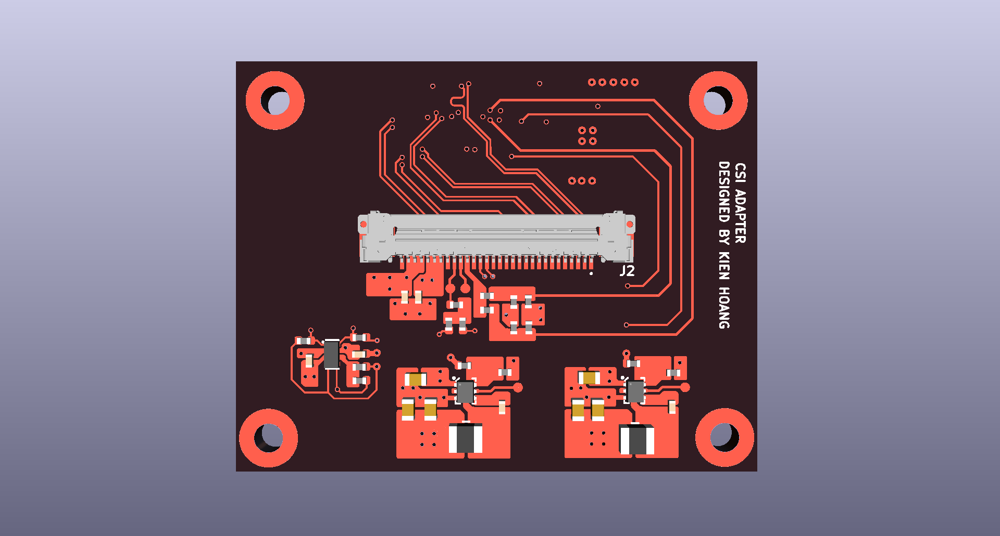
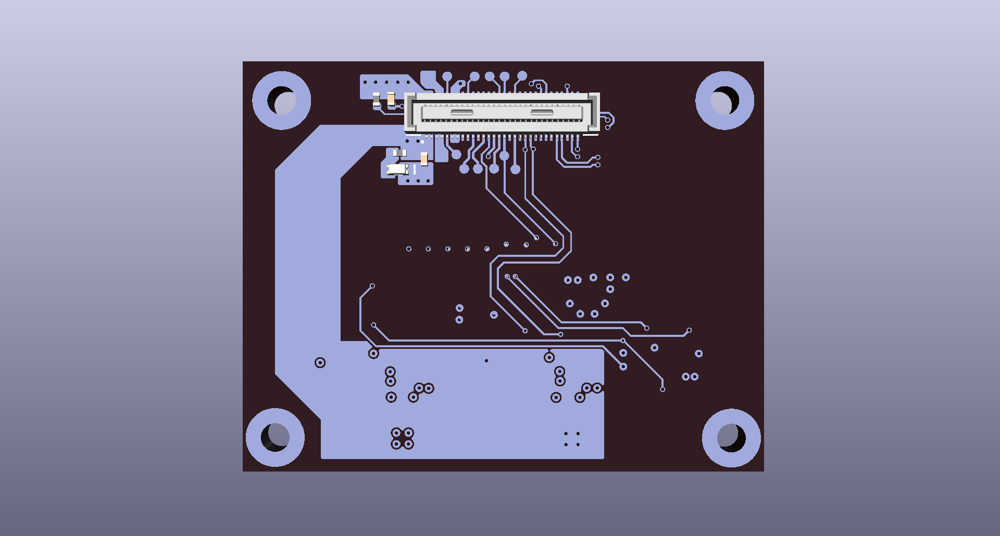

# FRAMOS CSI Adapter (Rev 1.1.2)

An adapter board converting **FRAMOS Sensor Adapter (FSA)** interface to a **30-pin CSI Interposer (I-PEX)** connector, supporting **4-lane MIPI CSI-2**, integrated camera power supplies, and I2C logic level translation.

---

## 3D Preview

| Top View | Bottom View |
| :---: | :---: |
|  |  |

> *Tip: Create an `images/` folder in your repository and export 3D renders from KiCad (`Alt + 3` -> `File -> Export Current View as PNG...`).*

---

## Key Features

- **Interfaces:**
  - **FSA Interface (`J1`):** Hirose `DF40C-60DS-0.4V(51)` (60-pin, 0.4 mm pitch).
  - **CSI Interposer (`J2`):** `MSAK24025P30` / compatible with `STE-I-PEX-20455-030E-12` (30-pin, matching cable `KAB-I-PEX-20453-030T-0500-1:1-ROUND`).
- **High-Speed Interface:** Supports **4-lane MIPI CSI-2** (`CSI_CLK` + `CSI_D0..D3`) routed for **100 Ω differential impedance**.
- **On-board Camera Power (from `5V0_SYS`):**
  - **3V8 Rail (`U2`):** `AP62301Z6-7` Buck Converter (2.2 µH / 1.6 A inductor).
  - **1V8 Rail (`U3`):** `AP62301Z6-7` Buck Converter (2.2 µH / 1.6 A inductor).
- **I2C Level Translation (`U1`):** `NTS0102` bidirectional translator (`1V8 <-> 3V3`) with `0 Ω` bypass resistor options (`R16`, `R17` DNP) for direct 1.8 V I2C operation.
- **Extras:** `3V8_CAM` power indicator LED (`D1`), 4× mounting holes (`MP1–MP4`), and full test point access (`TP1–TP21`).

---

## Hardware Specifications

- **EDA Tool:** KiCad 10
- **Layer Stackup:** 4 Layers (`Signal / GND / Power / Signal`)
- **Impedance Control:** 100 Ω Differential (MIPI CSI-2 lanes)
- **Mounting Holes:** 4× M2 (`2.2 mm` drill, `4.5 mm` pad)

